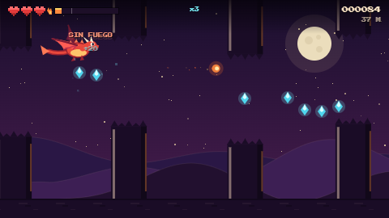

# 🐉 Dragón de Fuego

Juego de vuelo arcade y aventura de dragones hecho con HTML5 Canvas puro. Sin frameworks ni dependencias: el arte, las animaciones y el sonido se generan por código.



## Cómo jugar

1. Arranca **Apache** en XAMPP.
2. Abre `http://localhost/Johan/JuegoDragon/`.
3. Pulsa **JUGAR**.

No hace falta base de datos ni PHP: son archivos estáticos.

## Publicar en GitHub Pages

El workflow [deploy-pages.yml](./.github/workflows/deploy-pages.yml) publica el sitio al subir cambios a `main`. La primera vez, en GitHub abre **Settings → Pages** y selecciona **GitHub Actions** como fuente de publicación. Cuando termine la acción, el juego estará en `https://johanpro17.github.io/GamerDragons/`.

## Controles

| Acción | Teclado | Ratón / táctil |
| --- | --- | --- |
| Aletear | `Espacio`, `W` o `↑` | Clic / toque en la pantalla, botón **ALETEAR** |
| Escupir fuego | `X`, `Z`, `K` o `J` | Botón **FUEGO** |
| Pausa | `P` o `Esc` | Botón `II` |
| Silenciar | `M` | Botón `♪` |

## Modo aventura

Entra en **AVENTURA** para cuidar a Chimuelo y a la Furia Luminosa, mejorar su vínculo y salir a explorar. Alimenta, acaricia, entrena y descansa en el santuario; cada dragón guarda sus propios atributos y progreso en el navegador.

- **Vuelo de exploración**: recorre una travesía de 9 km a través de los Acantilados del Alba, las Islas Esmeralda, los Volcanes de Cristal y el Reino de las Auroras. El paisaje, el cielo y el mar cambian suavemente entre regiones.
- **Vuelo y obstáculos**: pulsa `Espacio`, `W` o `↑` para aletear. Recoge peces y cruza aros para conseguir recompensas; esquiva rocas. También puedes pulsar el botón **ALETEAR** o tocar el lienzo.
- **Progreso**: cada vuelo consume energía y fortalece el vínculo. El HUD indica la región, el avance, la distancia, los peces y los impactos recibidos.
- **Animación y renderizado**: la aventura se dibuja en Canvas 2D a resolución doble y usa capas con paralaje, iluminación y perspectiva para dar profundidad sin dependencias externas.

## Mundo 3D: bot, cooperativo y salas online

Selecciona **MUNDO 3D COOPERATIVO** y elige una modalidad:

- **1 jugador + bot**: explora con un compañero que sigue al jugador 1.
- **2 jugadores en el mismo dispositivo**: compartan el teclado o conecten dos mandos.
- **Sala online**: el jugador 1 crea la sala y comparte el código de seis dígitos; el jugador 2 lo escribe para unirse desde otro dispositivo.

El mundo de bloques se genera al avanzar. Bandadas de aves de colores aletean sobre los árboles y pequeños animales recorren las praderas; la fauna cambia de aspecto según la región y desaparece al alejarse para mantener el rendimiento. Se puede caminar, saltar y mantener pulsado el control de vuelo para elevarse. La cámara se aleja para que ambos dragones sigan visibles y el mundo no tiene un límite de recorrido.

| Jugador | Moverse | Saltar | Volar |
| --- | --- | --- | --- |
| 1 | `W`, `A`, `S`, `D` | `Espacio` | Mantén `F` |
| 2 | `↑`, `←`, `↓`, `→` | `Enter` | Mantén `R` |

En pantallas táctiles, mantén **VOLAR** para subir. También se admiten dos gamepads y controles táctiles separados para cada jugador. El movimiento es relativo a la cámara: cada dragón puede desplazarse en cualquier dirección, y arrastrar el ratón o el dedo sobre el mundo permite orbitar la vista 360° alrededor de los jugadores. Usa `Esc` para volver al menú.

El renderer 3D usa Three.js 0.149.0 y las salas cargan PeerJS 1.5.4 desde jsDelivr cuando se solicitan. La conexión de salas usa PeerJS Cloud para señalización y WebRTC para enlazar los navegadores; por ello, el modo online necesita Internet y depende de un servicio externo. GitHub Pages aloja los archivos estáticos del juego, pero no ejecuta el servicio de señalización. No se guardan cuentas ni perfiles en un backend.

## Mecánicas

- **Vuelo**: la gravedad tira del dragón; cada aleteo le da un impulso. El techo no hace daño, el suelo sí.
- **Corazones**: empiezas con 3. Un golpe cuesta un corazón y te da 1,6 s de invulnerabilidad. Las gemas de vida (`+VIDA`) recuperan uno.
- **Furia**: barra naranja de la parte superior. Cada bola de fuego cuesta 26 puntos y se regenera con el tiempo. También la recargan las gemas.
- **Gemas**: dan puntos según el combo (`x1` a `x5`). El combo sube con cada gema o murciélago quemado y se pierde al recibir daño o tras 3,2 s sin recoger nada.
- **Enemigos**: murciélagos que ondulan; se pueden quemar con fuego (+25 puntos).
- **Zonas**: cada 420 m cambia el escenario y la paleta (Valle de Brasa → Cañón de Ceniza → Cráter del Dragón → Aurora Helada).
- **Récord**: se guarda en `localStorage` y se muestra en el título y en el pie.

## Estructura

```
JuegoDragon/
├── index.html   Estructura, HUD de pantallas y controles
├── style.css    Marco arcade, scanlines, tipografías y diseño responsive
├── game.js      Motor completo (estado, física, arte, audio, entrada)
├── adventure.js Santuario, progresión de dragones y misiones de exploración
├── world3d.js   Mundo 3D procedural, bot, salas online y controles
└── README.md
```

### game.js de un vistazo

- `CFG`: gravedad, impulso de aleteo, velocidades, coste del fuego, tamaño de zona.
- `ZONES`: paletas de cada escenario.
- `sfx`: sintetizador WebAudio (osciladores + ruido, sin archivos de audio).
- `update()` / `render()`: lógica y dibujo; el canvas interno es **480 × 270** y se escala con nearest-neighbor.
- `drawDragon()`: dragón dibujado con elipses, curvas y polígonos (alas animadas).
- `window.dragonGame`: gancho de depuración para probar desde la consola (`dragonGame.startGame()`, `dragonGame.update(1/60)`, `dragonGame.render()`).

## Ajustar dificultad

Todo está en `CFG` (arriba de `game.js`):

```js
const CFG = {
  gravity: 760,      // más gravedad = caída más rápida
  flap: -228,        // impulso del aleteo (más negativo = más alto)
  scrollStart: 84,   // velocidad inicial del mundo
  scrollMax: 214,    // velocidad máxima
  fireCost: 26,      // coste de cada bola de fuego
  fireRegen: 15,     // furia recuperada por segundo
  invuln: 1.6,       // segundos de invulnerabilidad tras un golpe
  zoneLength: 420,   // metros por zona
  maxHearts: 3
};
```

Los tamaños de hueco y los intervalos de aparición se calculan en `spawnGate()` y `updateSpawning()` según la distancia recorrida.

## Compatibilidad

Probado en Chrome/Edge modernos. Usa APIs estándar (`Canvas 2D`, `WebAudio`, `localStorage`, container queries de CSS). En móvil aparecen botones táctiles automáticamente.
